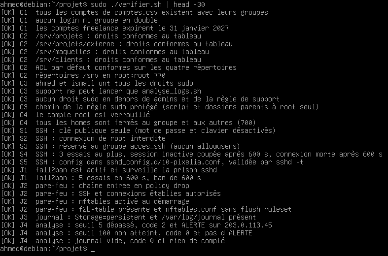
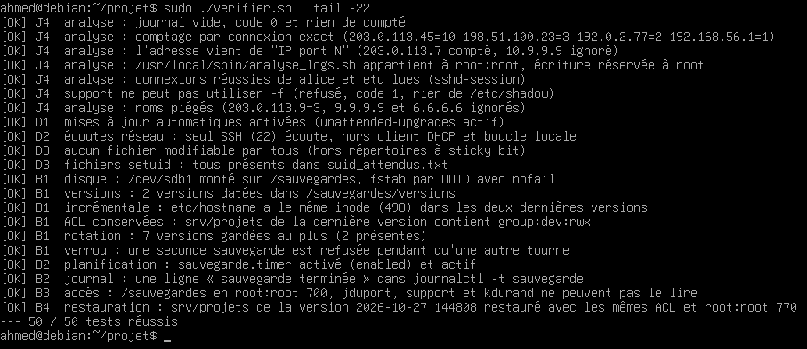

# Pixelia : durcissement de la VM Debian 13

## Contexte

Projet XTI302 (contexte A, agence web Pixelia). Une VM Debian 13 installée au minimum doit être durcie par des scripts, puis contrôlée par un script de vérification. Le dépôt contient tout ce qu'il faut pour reconstruire la machine depuis le snapshot « vierge » :

- `installer.sh` installe les paquets, copie les fichiers de `config/`, lance `creer_comptes.sh`, prépare le second disque et la planification ;
- `creer_comptes.sh` crée groupes, comptes, répertoires de `/srv` et ACL à partir de `comptes.csv`, et installe les clés publiques de `cles/` ;
- `analyse_logs.sh` produit un rapport des connexions SSH et renvoie 2 si un seuil d'échecs est atteint ;
- `sauvegarde.sh` crée une version datée de `/etc` et `/srv` sur le second disque ;
- `verifier.sh` teste chaque exigence (50 tests) sans rien modifier.

Le détail des choix est dans `DOSSIER.md`.

## Prérequis

- Une VM Debian 13 minimale avec le serveur SSH et un compte `ahmed` qui a sudo, sur laquelle le snapshot « vierge » a été pris.
- Un second disque virtuel de 2 Go, vu comme `/dev/sdb` et vide. L'installateur ne le formate que s'il ne contient aucune signature.
- Les clés publiques des comptes autorisés en SSH dans `cles/` : `ahmed.pub`, `ismail.pub` et `support.pub`. Seules les clés publiques sont dans le dépôt.
- Un accès à Internet depuis la VM (dépôts Debian officiels uniquement).

## Installation

Depuis le poste client, envoyer le dépôt dans `~/projet` sur la VM :

```
python outils/deployer.py envoyer
```

Puis, dans la VM :

```
cd ~/projet
sudo ./installer.sh
```

L'installateur peut être relancé sans danger : pas de doublon, et le disque de sauvegarde n'est pas reformaté.

Aucun mot de passe n'est stocké dans le dépôt. Après l'installation, un administrateur donne donc un mot de passe à `ismail`, sans lequel il ne peut pas utiliser sudo :

```
sudo passwd ismail
```

## Vérification

```
sudo ./verifier.sh
```

Le script affiche une ligne `[OK]` ou `[KO]` par test, puis le total. Il renvoie 0 si tout est conforme, 1 sinon. Voici la sortie sur une VM reconstruite depuis le snapshot vierge (début, puis fin avec le total).





## Poste client

`outils/deployer.py` tourne sur le poste Windows (Python 3 et paramiko). La commande `lancer` s'exécute dans `~/projet` et doit commencer par `sudo` pour utiliser ce mot de passe. L'outil se connecte à la VM `192.168.199.128` avec la clé `~/.ssh/vm_tp_ed25519`, et à défaut avec un mot de passe. Ce mot de passe, qui sert aussi pour sudo, est lu dans la variable d'environnement `VM_SUDO_MDP`. Il n'est écrit nulle part.

```
$env:VM_SUDO_MDP = '<mot de passe>'
python outils/deployer.py envoyer
python outils/deployer.py lancer "sudo ./installer.sh"
python outils/deployer.py lancer "sudo ./verifier.sh"
```

## Débannir une adresse

fail2ban bannit une adresse pendant 10 minutes après 5 échecs. La prison s'appelle `sshd` (voir `config/fail2ban/jail.d/sshd-pixelia.conf`). Pour lever un ban sans attendre, depuis un autre accès (console de la VM ou autre adresse) :

```
sudo fail2ban-client status sshd
sudo fail2ban-client set sshd unbanip <IP>
```
